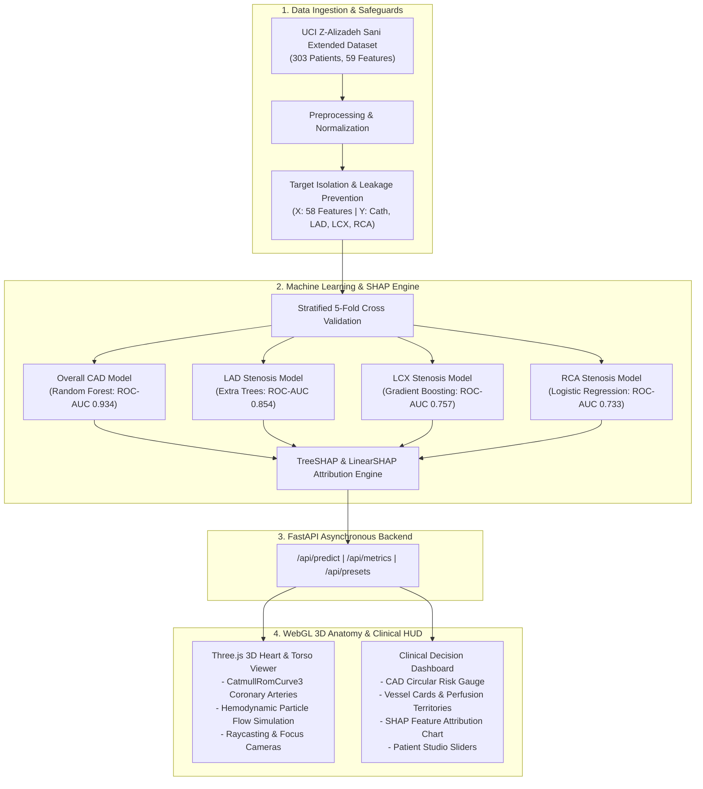

# CardioVision 3D: Cardiovascular Risk Visualization & Multi-Vessel Stenosis Prediction

[](https://github.com)
[](https://python.org)
[](https://fastapi.tiangolo.com)
[](https://threejs.org)
[](https://shap.readthedocs.io)
[](LICENSE)

> **Challenge:** Build an interactive 3D visualization system that predicts coronary artery disease (CAD) and overall cardiac risk from patient physiological and clinical data, mapping predictions directly onto an interactive 3D human anatomical model.

---

## ⚠️ Mandatory Clinical Safety Disclaimer
**FOR CLINICAL DECISION SUPPORT, ACADEMIC RESEARCH, AND DEMONSTRATION PURPOSES ONLY.**  
Predictions produced by this system are statistical machine learning estimations and are **NOT a substitute for formal diagnostic imaging** (e.g., invasive coronary catheter angiography or coronary computed tomography angiography [CTCA]).

---

## 🫀 Project Overview

Cardiovascular disease remains the leading cause of global mortality. While statistical calculators generate raw percentages, tabular scores fail to give clinicians or patients an intuitive spatial understanding of where and how pathology is developing inside the coronary vascular tree.

**CardioVision 3D** bridges advanced predictive machine learning and WebGL 3D anatomical visualization:
1. **Multi-Target Stenosis Classification:** Predicts both overall CAD status and vessel-specific stenosis ($\ge 50\%$ diameter narrowing) for:
   - **LAD (Left Anterior Descending Artery):** Supplies the anterior myocardial wall and interventricular septum.
   - **LCX (Left Circumflex Artery):** Supplies the posterolateral left ventricle.
   - **RCA (Right Coronary Artery):** Supplies the right ventricle, inferior wall, and conduction system (AV/SA nodes).
2. **Strict Target Leakage Safeguards:** Features `LAD`, `LCX`, `RCA`, and `Cath` are strictly eliminated from model input matrices to guarantee zero leakage.
3. **Interactive 3D Anatomical Mapping:** Real-time WebGL heart model rendering coronary artery trees that dynamically update their color coding:
   - 🟢 **Emerald Green:** Normal / Low Risk ($<35\%$)
   - 🟡 **Amber Orange:** Moderate Stenosis Risk ($35\% - 65\%$)
   - 🔴 **Crimson Red:** Severe Stenosis Risk ($>65\%$) with ischemic pulsation glow
4. **Hemodynamic Particle Simulation:** Blood cell particle streams travel along coronary curves; flow speed slows down at stenotic vessels to simulate vascular resistance!
5. **SHAP Clinical Explainability:** Real-time local feature attribution reveals exact physiological drivers (e.g., ST elevation, EF-TTE, RWMA, LDL, typical chest pain) pushing cardiac risk up or down.

---

## 🏗️ System Architecture



---

## 📊 Model Evaluation Benchmarks

All models were evaluated using Stratified 5-Fold Cross-Validation on the training split ($N=242$) and verified on an independent holdout test set ($N=61$).

| Target Clinical Endpoint | Selected Model Architecture | CV ROC-AUC (Mean ± Std) | Holdout ROC-AUC | Accuracy | F1-Score | Recall (Sensitivity) | Precision (PPV) |
| :--- | :--- | :---: | :---: | :---: | :---: | :---: | :---: |
| **Overall CAD (`Cath`)** | **Random Forest Classifier** | **0.9344 ± 0.024** | **0.8824** | **80.33%** | **87.50%** | **97.67%** | **79.25%** |
| **LAD Stenosis** | **Extra Trees Classifier** | **0.8544 ± 0.038** | **0.7865** | **70.49%** | **76.32%** | **85.29%** | **69.05%** |
| **LCX Stenosis** | **Gradient Boosting Classifier** | **0.7567 ± 0.041** | **0.7033** | **70.49%** | **60.87%** | **53.85%** | **70.00%** |
| **RCA Stenosis** | **L2-Regularized Logistic** | **0.7334 ± 0.035** | **0.7220** | **67.21%** | **47.37%** | **45.00%** | **50.00%** |

*Target Leakage Verification: `Cath`, `LAD`, `LCX`, and `RCA` features were strictly omitted from the model inputs ($X$).*

---

## 🚀 Quickstart & Setup

### Prerequisites
- Python 3.10+
- Modern Web Browser (Chrome, Edge, Firefox, Safari) with WebGL enabled.

### 1. Clone the Repository
```bash
git clone https://github.com/YOUR_USERNAME/cardiovascular-risk-3d.git
cd cardiovascular-risk-3d
```

### 2. Install Dependencies
```bash
pip install -r requirements.txt
```

### 3. (Optional) Re-train Models & Run Test Suite
The repository includes pre-trained model weights. To retrain from scratch:
```bash
# Downloads UCI dataset, processes features, trains models, evaluates metrics:
python src/data_loader.py
python src/preprocessing.py
python src/train.py
python src/generate_presets.py

# Run comprehensive test suite:
python tests/test_pipeline.py
```

### 4. Launch the Interactive Application
```bash
python run.py
```
Open your browser at **[http://127.0.0.1:8000](http://127.0.0.1:8000)**.

---

## 🎮 Interactive Features Walkthrough

1. **Clinical Presets Selector (Top Bar):**
   - **Case 1 (Triple Vessel CAD):** 68yo male with severe diffuse stenosis in LAD, LCX, and RCA. All three vessels glow crimson red with slowed flow.
   - **Case 2 (Isolated LAD "Widowmaker"):** Critical anterior stenosis with normal circumflex and right coronary perfusion.
   - **Case 3 (Isolated RCA Stenosis):** Inferior wall regional wall motion abnormality (RWMA) and isolated RCA narrowing.
   - **Case 4 (Healthy Control):** 45yo individual with clear coronaries and low risk across all vessels (all emerald green).
   - **Case 5 (Intermediate Risk):** Borderline hypertension and early atheroma.
2. **3D Camera HUD:**
   - Click **Focus LAD**, **Focus LCX**, or **Focus RCA** to smoothly transition the camera to that specific anatomical territory.
   - Click **Toggle Torso Cage** to visualize the translucent holographic ribcage for anatomical context.
   - Click **Toggle Blood Flow** to watch simulated blood cell particles pulsate through the coronary tree.
3. **Raycast Vessel Inspection:**
   - Click directly on any coronary artery in the 3D viewport to inspect its perfusion territory and view its localized SHAP feature attributions in the dashboard.
4. **Patient Studio Tab:**
   - Adjust patient vitals, lipids, ECG flags, and echo findings to see real-time updates on both the 3D heart and risk gauges!

---

## 📁 Repository Structure

```
cardiovascular-risk-3d/
├── data/
│   ├── raw/                       # Raw UCI Z-Alizadeh Sani extended dataset (.csv/.xlsx)
│   ├── processed/                 # Train/Test splits with target leakage safeguards
│   └── patient_presets.json       # Clinical cases for 1-click UI evaluation
├── docs/
│   └── roc_curves.png             # Multi-target ROC-AUC evaluation curves
├── models/
│   ├── cad_model.pkl              # Overall CAD classification model
│   ├── lad_model.pkl              # LAD stenosis classification model
│   ├── lcx_model.pkl              # LCX stenosis classification model
│   ├── rca_model.pkl              # RCA stenosis classification model
│   ├── preprocessor.pkl           # Scaler and categorical encoding state
│   └── metrics.json               # Full evaluation benchmarks and confusion matrices
├── src/
│   ├── data_loader.py             # Official UCI dataset download and caching
│   ├── preprocessing.py           # Feature engineering & target leakage prevention
│   ├── train.py                   # 5-Fold Stratified CV training & evaluation
│   ├── explainability.py          # SHAP local & global explainability engine
│   ├── generate_presets.py        # Clinical representative preset generator
│   └── api.py                     # FastAPI backend application
├── web/
│   ├── index.html                 # Main WebGL + Clinical HUD application
│   └── static/
│       ├── css/style.css          # Medical HUD theme styling
│       └── js/
│           ├── three.min.js       # Three.js 3D library (bundled offline)
│           ├── OrbitControls.js   # Orbit camera controls (bundled offline)
│           ├── chart.min.js       # Chart.js charting library (bundled offline)
│           ├── heart3d.js         # 3D anatomical heart engine & shaders
│           └── dashboard.js       # Clinical dashboard state controller
├── tests/
│   └── test_pipeline.py           # End-to-end automated test suite
├── requirements.txt               # Pinned Python package dependencies
├── run.py                         # Single-command application launch entrypoint
├── DOCUMENTATION.md               # Detailed 6-page comprehensive project report
└── README.md                      # This project documentation
```

---

## 📄 License
This project is open-source under the MIT License.
